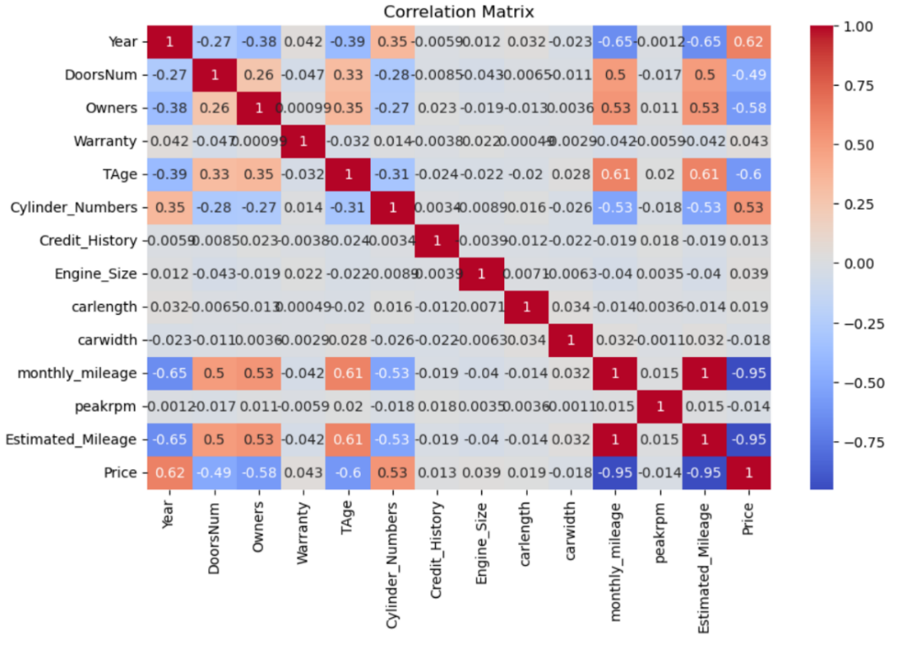
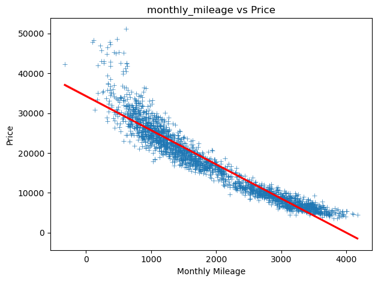
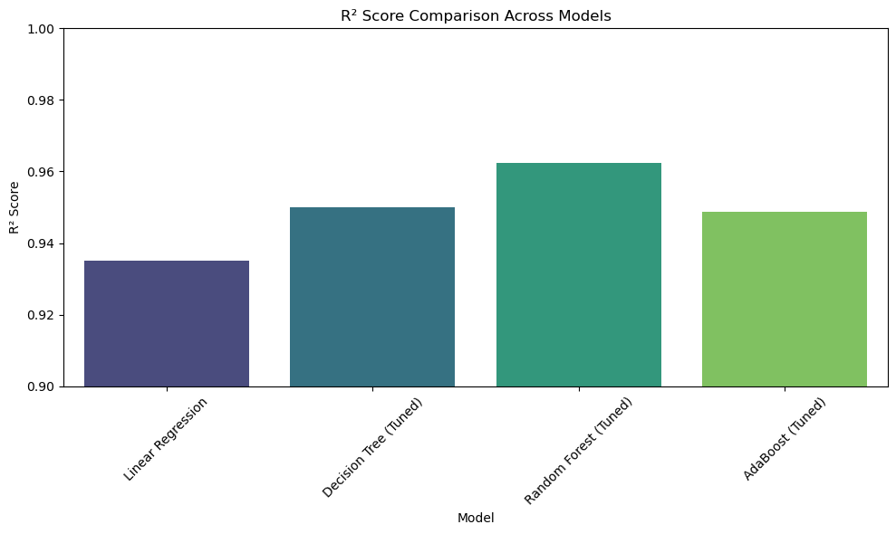

# Used Car Price Prediction

**Data Mining & Visualisation module, Aston University (group project, 5 members)**
**My role:** data cleaning, exploratory analysis and charts, model building and evaluation, and report writing
**Tools:** Python (basic, guided: pandas, scikit-learn, matplotlib/seaborn), Excel

---

## The business problem

Used car dealers, online marketplaces, lenders and insurers all need fair, accurate prices. Overprice and cars sit unsold. Underprice and you lose money. The goal was a data-driven model that predicts a used car's price from its features.

## The data

- **2,230 car listings × 32 columns**, with **2,197 records** after cleaning.
- A mix of numbers (price, mileage, engine size, owners, age) and categories (brand and model, colour, insurance, safety rating, wheels, features like leather seats and cruise control).

## 1. Data cleaning

The raw data was messy, so I standardised it column by column:
- fixed typos ("Petroll" to Petrol, "Brwn" to Brown, "AutoNamatic" to Automatic)
- corrected impossible values (doors "22" or "44" to 2 or 4, vehicle age "50" to 5)
- unified labels ("3rd party" to Third Party, "Exc" to Excellent, Y to Yes)
- converted text mileage into numbers, and set invalid entries to null

## 2. Exploratory analysis

- **Correlation:** monthly mileage and estimated mileage had a **−0.95** correlation with price, the strongest drivers. Year (+0.62), age (−0.60) and number of owners (−0.58) followed.
- **Chi-square:** for categorical features (leather seats, multimedia, cruise control and others).
- **Univariate and bivariate charts** to check distributions, skew and outliers.
- Chose the **10 strongest predictors**: monthly mileage, estimated mileage, model, colour, insurance, leather seats, safety, wheel type, cruise control and owners.

## 3. Modelling

- 80/20 train-test split. A scikit-learn `ColumnTransformer` and `Pipeline` handled preprocessing (mean imputation for numbers, encoding for categories).
- Linear regression as the baseline, then a decision tree, random forest, SVR, KNN and AdaBoost, with tuning on the best ones.
- Evaluated with **MAE, RMSE and R²**.

| Model | MAE | RMSE | R² |
|---|---|---|---|
| Linear Regression (baseline) | 1,647 | 2,269 | 0.935 |
| Decision Tree (tuned) | 1,368 | 1,989 | 0.950 |
| AdaBoost (tuned) | 1,494 | 2,016 | 0.949 |
| **Random Forest (tuned)** | **1,171** | **1,730** | **0.962** |

## Result

**The tuned random forest was best:** it explained about **96% of price variation**, with an average error of about **$1,171**. Example predictions:
- A one-owner Toyota Corolla with 10,000 miles: about **$28,280**
- A three-owner Ford Focus with 35,000 miles: about **$8,805**

**Why RMSE matters here:** big pricing errors are expensive for everyone (unsold stock, lost margin, bad loans), so the model was judged on how well it avoids large misses, not just on average accuracy.

## Files
- `images/`: charts from the analysis
- ----------
